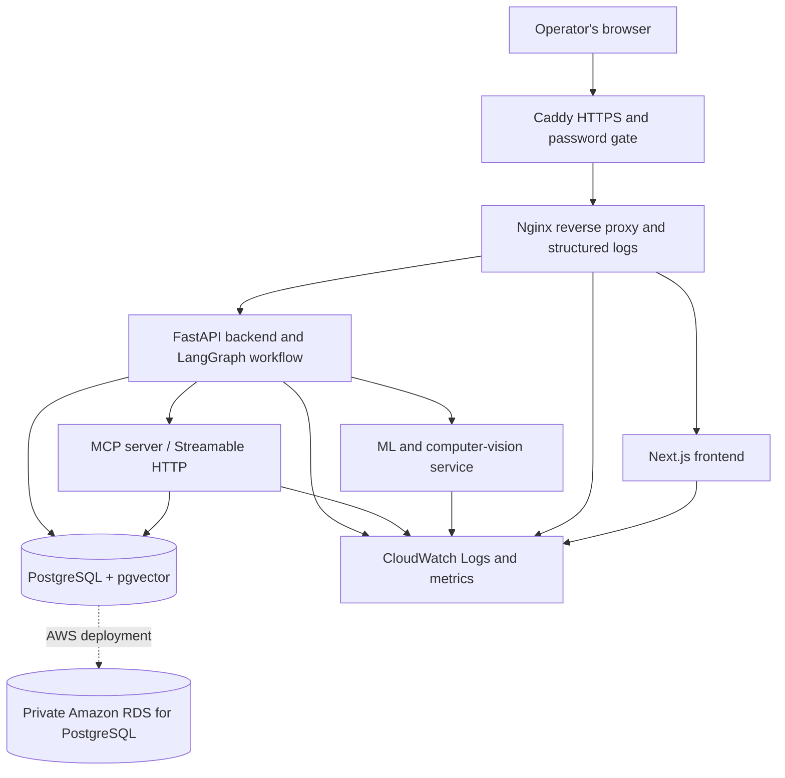

# NexCord

**A human-in-the-loop incident commander for live events, powered by an agent workflow and MCP tools.**

NexCord helps event teams reason through operational incidents such as equipment failures, room conflicts, unavailable staff, and overcrowding. It gathers operational context, proposes candidate responses, simulates resource changes, waits for a human decision, executes approved actions through tools, and verifies the resulting state.

> **Project status:** The multi-service Docker Compose app and its approval → execution → verification workflow have been tested on AWS. The hosted demo uses HTTPS and a shared password-protection layer. It is a hackathon/demo deployment, not a production-ready service.

**Live demo:** [https://nexcord-manish.duckdns.org](https://nexcord-manish.duckdns.org) (password required; provide reviewer credentials in Devpost's testing-instructions field, not in this repository.)  
**Source:** [github.com/msaimanish/NexCord](https://github.com/msaimanish/NexCord)

## Contents

- [Why NexCord?](#why-nexcord)
- [Core workflow](#core-workflow)
- [Architecture](#architecture)
- [Technology stack](#technology-stack)
- [Verified demo scenario](#verified-demo-scenario)
- [AWS deployment and observability](#aws-deployment-and-observability)
- [Run locally](#run-locally)
- [Useful Docker commands](#useful-docker-commands)
- [Data and persistence](#data-and-persistence)
- [Security and limitations](#security-and-limitations)
- [Documentation](#documentation)

## Why NexCord?

Live events depend on interrelated resources: rooms, people, vendors, equipment, and schedules. A single incident can cascade into schedule changes, resource conflicts, and attendee impact. NexCord explores how an agent can help an operator choose an informed response without treating generated text as authorization to act.

The guiding principle is:

**Observe → assess → propose → simulate → approve → execute → verify.**

Human approval is a required step in the intended action workflow. A generated plan is not, by itself, permission to execute it.

## Core workflow

1. **Observe:** collect event and operational state.
2. **Detect and assess:** identify an incident and evaluate its potential impact.
3. **Retrieve context:** use operational data and stored knowledge to ground a response.
4. **Generate candidate plans:** propose possible responses.
5. **Simulate:** evaluate plans against resource availability and constraints.
6. **Select a plan:** rank successfully simulated candidates using the application's current risk, delay, and cost criteria.
7. **Request human approval:** wait for the operator's decision.
8. **Execute through MCP:** send approved operations to the MCP server.
9. **Verify and recover:** check the resulting state and use recovery paths where supported.
10. **Audit:** retain plans, executions, and operational history for inspection.

## Architecture



The application is split into a Next.js frontend, FastAPI backend, agent workflow, MCP tool server, ML service, and PostgreSQL database. Docker Compose runs the containers. In the AWS deployment, PostgreSQL is hosted separately on private Amazon RDS. Caddy handles public HTTPS and password protection; Nginx routes requests to the frontend/backend and writes structured access logs.

## Technology stack

| Area | Technology | Role |
|---|---|---|
| Frontend | Next.js, React, TypeScript | Operator interface for incidents, plans, simulation, and approval |
| API | Python, FastAPI, Uvicorn | REST API and application services |
| Agent workflow | LangGraph | Stateful incident-response orchestration and approval/resume flow |
| Database | PostgreSQL | Events, incidents, resources, plans, executions, and audit records |
| Vector search | pgvector | Knowledge embeddings and retrieval |
| ORM and migrations | SQLAlchemy, Alembic | Database access and schema migrations |
| Tool integration | Model Context Protocol (MCP), Streamable HTTP | Route tool operations through a dedicated MCP server |
| ML / computer vision | PyTorch, torchvision, Faster R-CNN ResNet-50 FPN v2, OpenCV | Person detection and occupancy-related visual analysis |
| LLM | Google Gemini API | Language-model calls in the current application configuration |
| Local deployment | Docker, Docker Compose | Multi-service development environment |
| AWS deployment | EC2, Amazon RDS for PostgreSQL, Secrets Manager, Systems Manager Session Manager | Hosting, managed database, secret storage, and administrative access |
| Observability | CloudWatch Logs, metric filters and alarms; structured Nginx logs | Centralized logs, latency metrics, and error monitoring |
| Public access | Caddy, Let's Encrypt, DuckDNS | HTTPS certificate, password gate, and free subdomain |

## Verified demo scenario

The demonstrated scenario uses a **Robotics Final** event with a projector-failure incident. NexCord proposes allocating a backup projector, evaluates the resource change, and waits for the operator's approval.

The AWS end-to-end workflow was exercised as follows:

1. The agent generated a plan to allocate a backup projector.
2. The operator reviewed and approved the plan in the UI.
3. The approved action executed through the application/MCP workflow.
4. The UI reported execution completion and successful verification.

This demonstrates the workflow against the demo database. It is not a claim of production readiness or a load/performance benchmark.

## AWS deployment and observability

The AWS deployment uses `docker-compose.aws.yml`, the AWS-specific CPU-only image definitions `backend/Dockerfile.aws` and `ml/Dockerfile.aws`, and the routing configuration in `deploy/nginx.conf` and `deploy/Caddyfile`.

Configured AWS components include:

- **EC2:** hosts the Docker Compose application stack.
- **Amazon RDS for PostgreSQL:** private managed database with pgvector enabled.
- **AWS Secrets Manager:** stores database and LLM credentials used by the deployment.
- **AWS Systems Manager Session Manager:** administrative access without an inbound SSH rule.
- **Amazon CloudWatch Logs:** receives logs from the backend, MCP server, ML service, frontend, and Nginx; log retention was set to 14 days.
- **CloudWatch metric filters and alarms:** configured for service error events, API request latency, and HTTP 5xx responses.
- **Caddy and Let's Encrypt:** HTTPS for the demo subdomain; Caddy stores certificate state in named Docker volumes.
- **DuckDNS:** free subdomain with an EC2-side systemd timer that refreshes the record periodically to accommodate public-IP changes.

Nginx emits structured JSON access logs, including URI, HTTP status, request time, and upstream response time. A five-request smoke test produced a mean `request_time` of **4.4 ms** and a maximum of **5 ms**. This was a small endpoint verification sample, not a benchmark. Some service-error alarms had no matching datapoints during the last check and treated missing data as non-breaching; their `OK` state should not be interpreted as proof that every failure path was trigger-tested.

Do not add actual IP addresses, AWS account identifiers, database endpoints, secret values, or `.env` contents to public documentation.

## Run locally

### Prerequisites

- Git
- Docker Engine or Docker Desktop
- Docker Compose plugin
- The environment variables required by the local `docker-compose.yml`

### 1. Clone the repository

```bash
git clone https://github.com/msaimanish/NexCord.git
cd NexCord
```

### 2. Configure the environment

Copy and edit the example environment file if it is present in your checkout:

```bash
cp .env.example .env
```

Provide the variables required by the current local Compose configuration. For example:

```dotenv
POSTGRES_PASSWORD=replace_with_a_strong_local_password
GEMINI_API_KEY=replace_with_your_key_if_needed
```

Use the exact variable names required by the current configuration. Never commit real credentials, API keys, database credentials, `.env` files, or SQL backups.

### 3. Build and start services

```bash
docker compose up --build -d
docker compose ps
```

### 4. Verify the API

```bash
curl -i http://127.0.0.1:8000/health
```

A healthy API returns HTTP `200 OK` with a response similar to:

```json
{"status":"ok","service":"nexcord-api"}
```

Open the frontend at [http://127.0.0.1:3000](http://127.0.0.1:3000).

### Local service addresses

| Service | Local address | Notes |
|---|---|---|
| Frontend | `http://127.0.0.1:3000` | Operator UI |
| Backend API | `http://127.0.0.1:8000` | FastAPI service |
| Health check | `http://127.0.0.1:8000/health` | API health endpoint |
| MCP server | `127.0.0.1:8001` when published | Streamable HTTP endpoint is `/mcp`; a plain browser request is not a valid MCP protocol test |
| ML service | `127.0.0.1:8100` when published | Prediction/vision service |
| PostgreSQL | `127.0.0.1:5432` when published | Local database |

Keep local development ports bound to localhost. Do not expose the development database or internal service ports directly to the public internet.

## Useful Docker commands

```bash
# View running services
docker compose ps

# Follow logs from all services
docker compose logs -f

# Follow backend logs
docker compose logs -f backend

# Rebuild and restart after code/config changes
docker compose up -d --build

# Stop services while retaining named volumes
docker compose down
```

> **Data-loss warning:** `docker compose down -v` removes Compose-managed volumes and can delete local PostgreSQL data. Use it only when intentionally resetting the database and after verifying that any needed data is backed up.

## Data and persistence

The PostgreSQL schema covers events, venues, rooms, people, teams, vendors, equipment, reservations, incidents, plans, plan actions, executions, notifications, audit records, operational observations, knowledge documents/chunks, and LangGraph checkpoints.

The local database uses a named Docker volume, so ordinary container recreation should not delete its data. Create and verify a backup before migrations, major changes, or database moves. Treat backups as sensitive and keep them out of the public repository. The local MLflow tracking database is generated evaluation data and is intentionally excluded from Git.

## Security and limitations

The hosted demo is served at [https://nexcord-manish.duckdns.org](https://nexcord-manish.duckdns.org). HTTPS is terminated by Caddy with a Let's Encrypt certificate; a shared HTTP Basic Auth credential protects the demo. Reviewer credentials should be provided through Devpost's testing instructions, never committed to this repository.

This is a hackathon demo, not a production-secure service:

- Basic Auth is a single shared credential, not per-user authentication, role-based authorization, or a full identity system.
- The application should not be used to control real event operations without further access controls, operational validation, and failure testing.
- Keep `.env`, API keys, database credentials, password hashes, and SQL backups out of version control.
- RDS is intended to remain private and accept database connections only from the application security group.
- Person detection was tested using a sample image; a live camera/video integration is not demonstrated by that test.
- ML predictions and agent-generated plans provide decision support, not a substitute for operator judgment.
- Some CloudWatch error alarms had no matching data in the last check. Validate alarm behavior deliberately before relying on it for production incident response.

## Documentation

- [Architecture](docs/architecture.md)
- [AWS deployment notes](docs/deployment-aws.md)
- [Demo runbook](docs/demo-runbook.md)
- [Friction log](docs/friction-log.md)