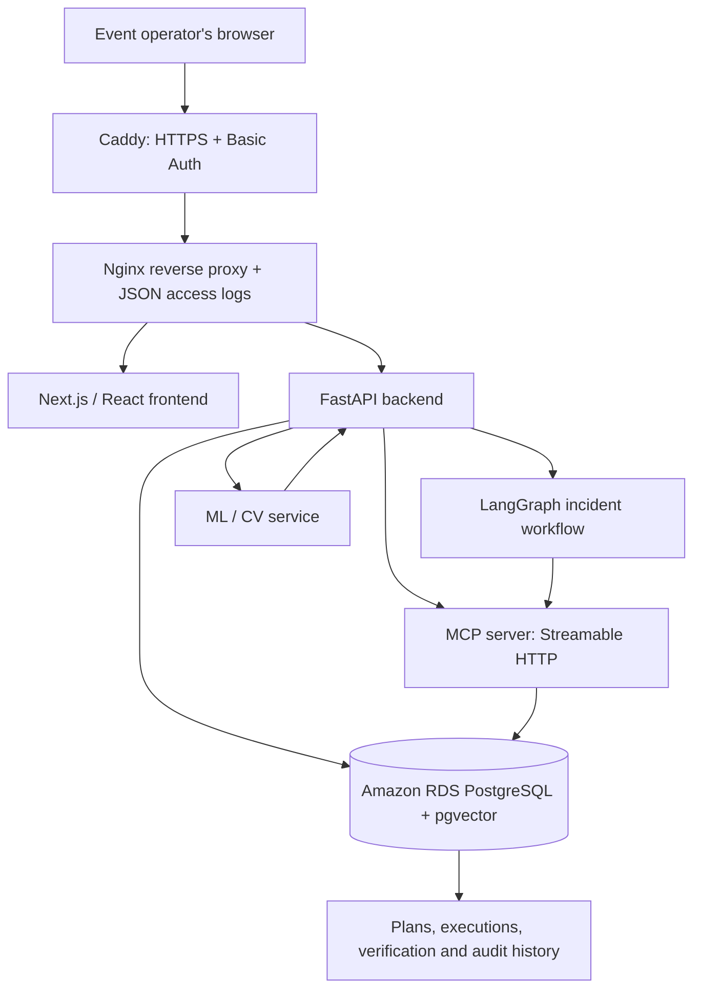

# NexCord Architecture

NexCord is a human-in-the-loop incident commander for live-event operations. Its core lifecycle is **observe → assess → propose → simulate → approve → execute → verify**.

## Components

## Request and decision flow

1. The operator opens an event and incident in the frontend.
2. The backend retrieves event, incident, room, equipment, people and other operational state from PostgreSQL. Retrieval and ML components provide supporting context where configured.
3. The agent proposes a response and candidate plan actions.
4. The application simulates the proposed changes against available resources and constraints before execution.
5. The operator explicitly approves the selected plan. Proposal generation alone does not authorize action.
6. The backend calls the self-hosted MCP server over Streamable HTTP for constrained tool execution.
7. The system verifies the resulting state and records execution/verification information. Recovery behavior is available where supported.

## Network boundaries in the AWS Compose deployment

- **Public edge:** Caddy publishes ports 80 and 443. It redirects HTTP to HTTPS, uses an automatically managed Let's Encrypt certificate, and applies HTTP Basic Authentication.
- **Edge network:** Caddy, Nginx, frontend and backend share the network needed for HTTP routing.
- **Application network:** backend, MCP server and ML service use a separate Docker network for service-to-service requests. The backend joins both networks to connect the public edge to internal services.
- **Database:** Amazon RDS PostgreSQL is private. Its security group allows PostgreSQL traffic only from the application security group.
- **Administrative access:** AWS Systems Manager Session Manager is used rather than opening SSH to the internet.
- **Secrets and observability:** Secrets Manager holds application secrets. Container logs go to dedicated CloudWatch log groups; Nginx emits structured JSON request logs for latency/HTTP status metrics.

## Important boundaries and limitations

- NexCord is a prototype, not a certified life-safety or emergency-response system.
- A human approval gate is part of the designed workflow; do not describe it as comprehensive enterprise authorization/RBAC.
- The live demo uses seeded/sample event data, not a connected real-world venue.
- The frontend is protected by shared HTTP Basic Authentication at the reverse proxy. This is suitable for a controlled demo, not a replacement for production user identities, per-user authorization, or audit-ready access management.
- Amazon Bedrock and S3 are not used. Kubernetes/Helm and the additional hardening phase were intentionally excluded.
- Native Alexa+ device/partner-console integration was not implemented; NexCord demonstrates its self-hosted MCP server through the project's own UI/client.

## Technology summary

Next.js, React, TypeScript, Python, FastAPI, LangGraph, MCP over Streamable HTTP, PostgreSQL, pgvector, SQLAlchemy, Alembic, PyTorch/Torchvision, OpenCV, Docker Compose, EC2, RDS, Secrets Manager, Systems Manager, CloudWatch, Caddy and Nginx.
